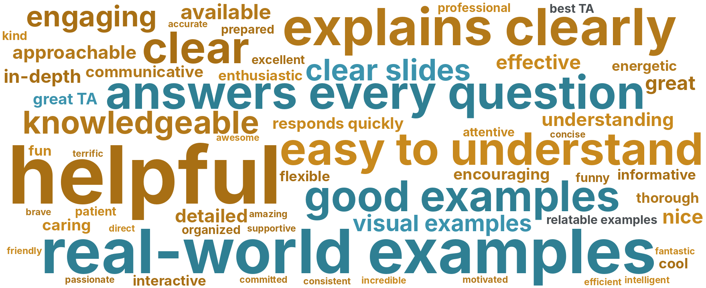
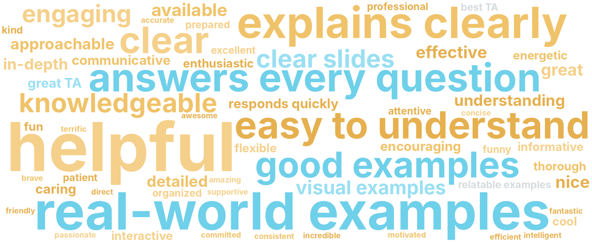

## Teaching Statement


TEACHING CLIP: upload the video to YouTube (unlisted is fine), replace VIDEO_ID below,
and move the div above this comment block.

  <iframe src="https://www.youtube.com/embed/VIDEO_ID" title="Teaching clip" style="position:absolute;top:0;left:0;width:100%;height:100%;" frameborder="0" allowfullscreen></iframe>



For most of my students, introductory economics is the only economics course they will ever take. My aim is that they leave able to use a handful of ideas (trade-offs, incentives, what a price is telling you) on decisions they actually face. My teaching rests on four principles.

1. **Interaction.** Students learn by doing. Introductory classes should be driven by games and hands-on practice throughout, using in-class activities and quizzes that run on students' own devices. In technical or advanced classes, producing code and output becomes mandatory: students apply a method from the course to a real-world question of their choice, such as an essay analyzing Brexit in a macroeconomics class, or a short study of demographics, labor or health using Current Population Survey data, with whatever tools they like.
2. **A reality check.** Concepts should connect to something students recognize from their own lives.
3. **Attention.** Understanding a topic in class is far more efficient than reviewing slides or asking AI about it after class. Occasional clips from TV help catch students' attention and test how well they can apply concepts, but sustained engagement depends on the instructor's own delivery.
4. **AI as part of learning.** AI should be an important part of learning, built into course materials rather than used to complete assignments. Students can use it to get past technical obstacles, such as debugging code or drawing diagrams, to ask questions about concepts, to generate practice questions, and to evaluate their own thinking and original work. How much AI to allow depends on the level. In introductory courses, it should be kept to a minimum and allowed only for debugging, because good habits and a sense of technical responsibility need to be instilled early. In advanced courses, AI use is expected and even encouraged, but accountability stays with the student: they build and maintain their own code base independently, and understand it well enough to revisit it at any point in their careers. At every level, exams and quizzes are strictly AI-free.

In a large course, fairness has to be designed in. When I took over a 530-student lecture mid-quarter, I coordinated seven teaching assistants, wrote exams in five randomized versions, and handled integrity cases and accommodations myself. I treat assessment as measurement: for my summer course I built tiered question banks, ran an item analysis on the midterm and used it to revise the final. With technical material I start by hand: in a machine learning course, students worked the forward pass and backpropagation on paper before they wrote a line of code.

## Student Comments

<figure class="comment-cloud">

<figcaption>How students described my teaching, from all 248 positive comments across my courses. Gold: words for the instructor. Blue: what the teaching offered. Larger means more comments.</figcaption>
</figure>

Selected comments from end-of-course surveys and official evaluations, quoted as written. Where a card shows stars, they are the rating the same student gave for overall teaching effectiveness (out of 5). Official evaluations are anonymous and do not tie a comment to a rating, so those cards show the course or section average instead.

<figure class="quote-card quote-card--lecture">
<figcaption>ECON 003 online course, Summer 2026</figcaption>

Course average 4.61–4.74 / 5

<blockquote>Professor Li is an incredible teacher, he keeps the slides and information up to date by providing recent events. He also explains the examples incredibly well which helped my learning of the topic.</blockquote>
</figure>
<figure class="quote-card quote-card--lecture">
<figcaption>ECON 003 lecture, Winter 2026</figcaption>

★★★★★

<blockquote>Overall, this class has been the best class I have taken so far at UCR. [...] The slides provided were also super clear and easy to follow.</blockquote>
</figure>
<figure class="quote-card">
<figcaption>ECON 103 Intermediate Macroeconomics, Fall 2020</figcaption>

Section average 6.73 / 7

<blockquote>Che is a really great TA. He understood the student's struggles during this uncertainty time and made extra effort in helping the student to understand the class's materials better.</blockquote>
</figure>
<figure class="quote-card">
<figcaption>ECON 003 discussion section, Spring 2025</figcaption>

Section average 6.22 / 7

<blockquote>Showed great understanding of the subject and helped further our understanding by using proper terminology (still able to explain to us in a simpler way) and showing us how to get the solutions.</blockquote>
</figure>
<figure class="quote-card">
<figcaption>ECON 103 Intermediate Macroeconomics, Fall 2020</figcaption>

Section average 6.25 / 7

<blockquote>Excellent instructing skills and helpful in the breaking down of the subject matter. Very enthusiastic and genuinely cared about student success.</blockquote>
</figure>
<figure class="quote-card quote-card--lecture">
<figcaption>ECON 003 lecture, Winter 2026</figcaption>

★★★★★

<blockquote>He taught our discussion and our lecture very well when he took over for our professor. He really knows the material and is the most knowledgeable TA I've been taught by so far.</blockquote>
</figure>
<figure class="quote-card quote-card--lecture">
<figcaption>ECON 003 online course, Summer 2026</figcaption>

Course average 4.61–4.74 / 5

<blockquote>allowed retakes on quizzes and tests so it was okay to make mistakes and learn</blockquote>
</figure>
<figure class="quote-card">
<figcaption>ECON 101 Statistics for Economics, Fall 2022</figcaption>

Section average 7.00 / 7

<blockquote>One of the best TA in UCR in my opinion.</blockquote>
</figure>
<figure class="quote-card">
<figcaption>ECON 105A Intermediate Macroeconomic Theory, Fall 2021</figcaption>

Section average 6.67 / 7

<blockquote>Che Li is a great TA. I really liked the discussion course with Che Li because it was a very helpful discussion course to help us catch up if we fell behind in the lectures or with homework.</blockquote>
</figure>
<figure class="quote-card quote-card--lecture">
<figcaption>ECON 003 lecture, Winter 2026</figcaption>

★★★★☆

<blockquote>Engaged and did activities with the class despite its large size and used fun/relatable examples for better understanding.</blockquote>
</figure>
<figure class="quote-card">
<figcaption>ECON 103 Intermediate Macroeconomics, Summer 2021</figcaption>

Section average 7.00 / 7

<blockquote>Best Econ TA instructors and was always prepared. He took his time to review the homework, questions, lecture material, and review for exam. He was so patient and overall really helpful in understanding tough material.</blockquote>
</figure>
<figure class="quote-card">
<figcaption>ECON 105A Intermediate Macroeconomic Theory, Fall 2021</figcaption>

Section average 6.50 / 7

<blockquote>He helped explain concepts covered in class and made it easier to understand what was taught. Also went over practice problems that helped us get a better understanding of the homework. Was very helpful during office hours in regards to problem sets and the term paper.</blockquote>
</figure>
<figure class="quote-card">
<figcaption>ECON 002 Introduction to Macroeconomics, Winter 2021</figcaption>

Section average 6.10 / 7

<blockquote>Extremely help full during the discussion. I never left the class confused because all my questions would get answered.</blockquote>
</figure>
<figure class="quote-card quote-card--lecture">
<figcaption>ECON 003 lecture, Winter 2026</figcaption>

★★★★★

<blockquote>Informative, engaging slides. Good lectures, better teacher.</blockquote>
</figure>
<figure class="quote-card">
<figcaption>ECON 003 discussion section, Fall 2025</figcaption>
<blockquote>The structure of the discussions made the entire course in general non-stressful and I really liked that</blockquote>
</figure>
<figure class="quote-card">
<figcaption>ECON 103 Intermediate Macroeconomics, Fall 2020</figcaption>

Section average 6.73 / 7

<blockquote>Prepared, professional, and cool guy!</blockquote>
</figure>
<figure class="quote-card">
<figcaption>ECON 002 Introduction to Macroeconomics, Spring 2021</figcaption>

Section average 6.38 / 7

<blockquote>He explained concepts very well and I actually enjoyed attending his discussions</blockquote>
</figure>

## Instructor of Record, UC Riverside

* ECON 003, Introduction to Microeconomics (Summer 2026). Evaluations: 4.61–4.74 out of 5. [Course materials](https://github.com/liche0907/Summer-Econ-003-Course-Materials)
* ECON 003, Introduction to Microeconomics (Winter 2026). 530 students; 81% of 226 survey respondents rated me an effective teacher overall.

## Teaching Assistant, UC Riverside

* ECON 111, Machine Learning for Economics and Business (Spring 2026). Designed and taught the deep learning unit. [Unit materials](https://github.com/liche0907/Econ111-Deep-Learning-Teaching)
* ECON 003, Introduction to Microeconomics (Winter 2023, Spring 2025, Summer 2025, Fall 2025)
* ECON 002, Introduction to Macroeconomics (Winter 2021, Spring 2021, Spring 2023, Fall 2023, Spring 2024)
* ECON 101, Statistics for Economics (Fall 2022)
* ECON 103, Intermediate Macroeconomics (Fall 2020, Summer 2021, Winter 2022)
* ECON 104B, Intermediate Microeconomic Theory (Winter 2024)
* ECON 105A, Intermediate Macroeconomic Theory (Fall 2021, Spring 2022)

## Teaching Assistant, Tufts University

* Advanced Macroeconomic Theory I and II, graduate level (Fall 2016, Spring 2017)
